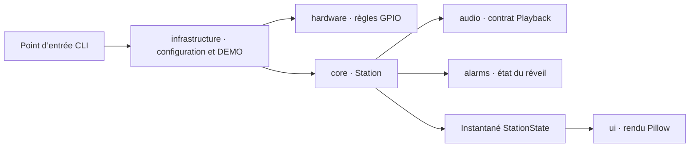

# Architecture d’Audio Station

Le programme cible un lecteur musical et radio-réveil autonome sur Raspberry Pi 3, avec une seule sortie stéréo via HiFiBerry MiniAmp. La logique applicative reçoit des commandes indépendantes de leur origine. La composition des adaptateurs est explicite au point d’entrée.

| Module | Responsabilité | Élément livré en S0 |
| --- | --- | --- |
| `core` | Orchestrer les commandes et exposer un état cohérent à l’interface | `Command`, `Station` et `StationState` |
| `ui` | Transformer un état en framebuffer et, à terme, associer des zones tactiles à des commandes | Rendu Pillow RGB 320 × 240 et état de lecture, de veille ou de réveil |
| `hardware` | Encadrer l’affectation des GPIO et héberger les futurs adaptateurs pour écran, tactile et commandes | Réservations BCM et validation pure des propositions de GPIO |
| `audio` | Définir le contrat de lecture et fournir ses implémentations | Protocole `Playback`, instantané `PlaybackState`, lecteur en mémoire |
| `alarms` | Gérer le cycle de vie du réveil et ses futures règles de déclenchement | État `Alarm` déclenché par le scénario et arrêt idempotent |
| `infrastructure` | Charger la configuration et assembler les dépendances | Config TOML validée et scénario déterministe |

`Station.handle` reçoit une commande à la fois. `Station.snapshot` construit un instantané immuable. Le rendu reçoit cet instantané directement, sans accès à l’audio ou aux GPIO. Les futurs adaptateurs du tactile, des boutons et de l’encodeur convergeront vers les mêmes commandes. Les politiques propres à la DEMO sont bornées au scénario : pause en entrant en veille, réveil déclenché explicitement et arrêt possible pendant la veille.

Le mode DEMO assemble uniquement des objets Python en mémoire. Ses seules entrées et sorties explicites sont la trace dans le terminal, le fichier TOML optionnel et le PNG demandé avec `--output`. Le validateur de GPIO contrôle les réservations MiniAmp, les lignes de la route SPI0 candidate et l’unicité des affectations directes. L’exemple S0 laisse les GPIO individuels à confirmer.

Le futur chemin audio reçoit des médias locaux et des flux radio, les décode puis les dirige vers une sortie stéréo locale. Le choix du moteur de lecture et le routage vers le périphérique ALSA seront validés sur le Pi lors des sprints concernés. Le réveil utilisera une horloge injectable et une sonnerie locale de secours. Les interfaces seront étendues quand ces usages seront implémentés.

Le rendu S0 utilise la police embarquée de Pillow. Le gabarit Inter et la prévisualisation interactive sont planifiés dans S1. Le [contrat matériel](HARDWARE_CONTRACT.md) encadre la transition du framebuffer simulé vers le TFT.
