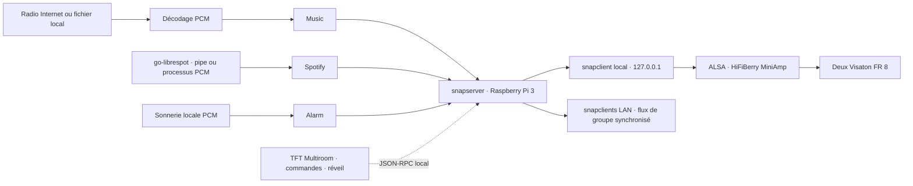

# Architecture d’Audio Station

Audio Station est un lecteur musical stéréo, un radio-réveil et un point de diffusion multiroom autonome. Le Raspberry Pi 3 héberge le `snapserver` dédié et son premier `snapclient`, configuré pour joindre le serveur à `127.0.0.1`. Ce client possède la sortie ALSA du HiFiBerry MiniAmp et alimente les deux Visaton FR 8 de 8 Ω. D’autres clients Snapcast pourront rejoindre le serveur sur le réseau local pour écouter le même flux en synchronisation.

## Circulation de l’audio

`snapclient` est l’unique utilisateur de la carte ALSA HiFiBerry en fonctionnement normal. Les producteurs alimentent les entrées de `snapserver` avec du PCM. Chaque groupe reçoit un flux, et `Alarm` est réservé par défaut au groupe isolé du client local. Le serveur reste fonctionnel sur la boucle locale pour les fichiers et sonneries présents sur le Pi, y compris quand Internet est indisponible. Radio Internet et Spotify dépendent de leurs services distants.

| Flux | Producteur | Contrat PCM à qualifier sur le Pi |
| --- | --- | --- |
| `Music` | Décodeur des radios et fichiers locaux | 48 000 Hz, 16 bits signés little-endian, stéréo entrelacée |
| `Spotify` | go-librespot via FIFO ou via processus qui fournit le PCM sur sa sortie standard | 44 100 Hz candidat, 16 bits signés little-endian, stéréo entrelacée. Vérifier les octets de la version retenue. |
| `Alarm` | Sonnerie locale décodée vers une entrée distincte | 48 000 Hz, 16 bits signés little-endian, stéréo entrelacée |

Snapcast reçoit un format fixe par source. Le signal réellement produit et celui accepté par le périphérique ALSA seront vérifiés séparément. Le détail de la commande, du routage du réveil et de la qualification se trouve dans le [contrat Snapcast](SNAPCAST_ARCHITECTURE.md). [Configuration officielle de Snapcast](https://github.com/snapcast/snapcast/blob/develop/doc/configuration.md#sources), [Schéma officiel de go-librespot](https://github.com/devgianlu/go-librespot/blob/master/config_schema.json)

## Contrôle et modules

| Module | Responsabilité cible | Socle S0 |
| --- | --- | --- |
| `core` | Traiter les commandes, distinguer les actions locales des actions partagées et publier des instantanés confirmés | `Command`, `Station` et `StationState` |
| `ui` | Rendre le TFT, dont la vue Multiroom, les clients présents, leurs groupes, leurs flux et les volumes | Framebuffer Pillow RGB 320 × 240 et états lecture, veille, réveil |
| `hardware` | Convertir tactile, GPIO et encodeur en commandes. L’encodeur cible le volume du client local. | Validation pure des réservations BCM |
| `audio` | Produire et vérifier le PCM. Définir les contrats de lecture et de gestion Snapcast. | `Playback`, `PlaybackState` et lecteur en mémoire |
| `alarms` | Programmer et jouer la sonnerie locale, isoler la sortie, vérifier puis restaurer le routage | Drapeau de réveil déclenché et arrêté dans le scénario |
| `infra` | Charger les profils et adapter le transport JSON-RPC, les producteurs PCM et leurs cycles de vie | Configuration TOML et assemblage de la DEMO |

L’adaptateur utilise l’API JSON-RPC officielle. Il recense les clients à partir de `Server.GetStatus`, suit les notifications et resynchronise son état après une reconnexion. Il gère les membres, les flux et le mute des groupes. Le volume d’un groupe est une opération d’Audio Station qui applique `Client.SetVolume` à chacun de ses membres et confirme les résultats. L’encodeur agit sur le client local identifié par configuration. [API de contrôle Snapcast](https://github.com/snapcast/snapcast/blob/develop/doc/json_rpc_api/control.md)

Le réveil mémorise le routage utile avant d’isoler le client local. Il alimente `Alarm` après confirmation de l’isolement et préserve la lecture des autres clients. L’arrêt coupe d’abord le PCM. La reprise du groupe initial dépend ensuite de l’état confirmé et des changements survenus depuis l’isolement. Un rétablissement incertain est signalé dans l’interface et laisse la sonnerie à l’arrêt.

## Effet sur le socle S0

- Le lecteur en mémoire, la DEMO hors ligne et le rendu Pillow restent les outils de développement. La sortie ALSA appartient au `snapclient` dans le chemin réel. Le futur décodeur est une source PCM de `Music`.
- Le volume simulé de `PlaybackState` doit être complété par un modèle des clients et groupes confirmé par le serveur. Une rotation d’encodeur cible le client local. La veille locale doit préserver l’écoute des autres clients. Aucun ordre de veille ne doit arrêter automatiquement une source partagée.
- Le drapeau de réveil de S0 ne couvre que l’affichage de la DEMO. Le réveil réel exige une machine d’état pour l’isolement, la coupure et la restauration après incident.
- La configuration TOML de la DEMO reste sans service ni accès réseau. Les profils réels devront identifier explicitement le serveur et le client local. Le premier essai matériel passe par Snapcast en S1. S11 mesure la synchronisation de deux clients physiques ou plus.
- Les imports historiques `audio_station.infrastructure` délèguent à `audio_station.infra`. Les nouveaux adaptateurs utilisent `infra`.

## Invariant vérifié en CI

Les fournisseurs Python produisent du PCM ou des états simulés. En production, seul le binaire externe `snapclient` ouvre la sortie MiniAmp. Le [test d’architecture](../tests/test_audio_architecture.py) repère les accès ALSA directs, notamment les liaisons ALSA, chemins de périphérique et commandes de lecture directe. Il couvre le code Python du paquet et complète le test de la DEMO sous garde d’entrées-sorties. L’ouverture réelle et l’exclusivité restent à vérifier sur le Pi en S1.

Le VPS reste dédié au développement et aux simulations. Les ports Snapcast sont limités à la boucle locale ou au réseau local autorisé. L’instance est dédiée à Audio Station. Toute installation de service ou modification système nécessite l’accord explicite de l’utilisateur. Voir la [spécification produit](PRODUCT_SPEC.md), le [plan de sprints](SPRINTS.md), le [contrat matériel](HARDWARE_CONTRACT.md) et la [procédure de déploiement](DEPLOYMENT.md).
